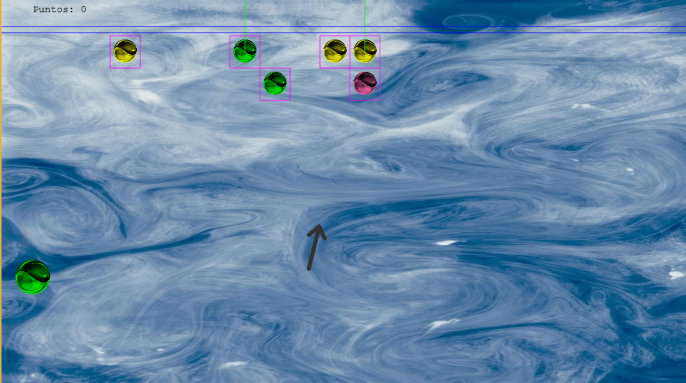
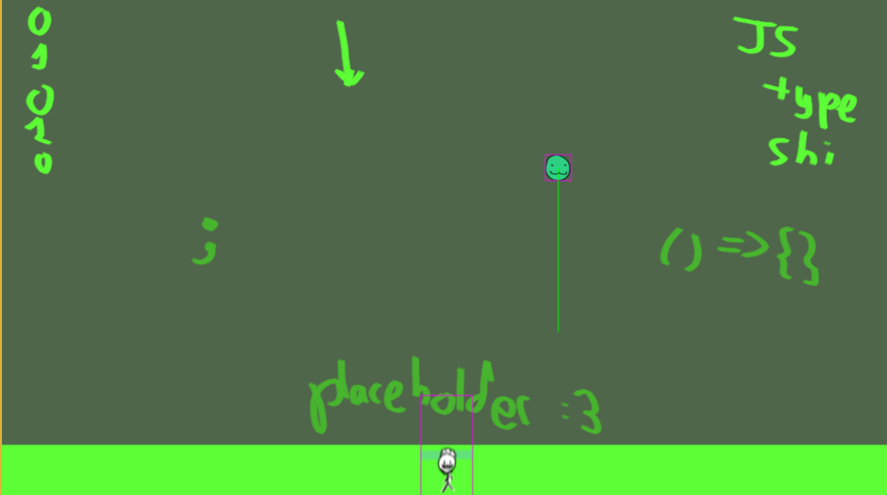
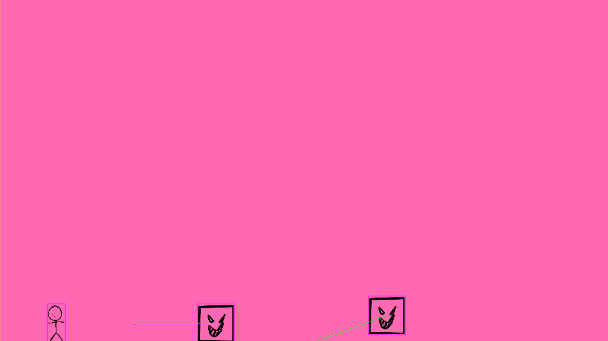
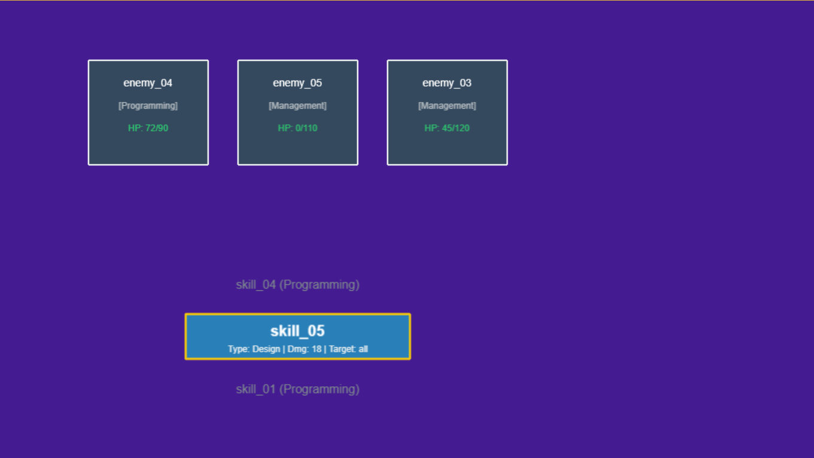

### Cómo entrenar a tu profesor
## Un juego de Mini Sushis Studio
**ESTO ES UN PROYECTO DE TRABAJO UNIVERSITARIO !!!!!111!!!! CUIDADO**
## Descripción
Ey muy buenas a todos guapisimos pues mira el juego va de entrenar a un profesor de la Facultad de Informática de la Universidad Complutense de Madrid  
Se entrena completando minijuegos varios y consiguiendo puntos de aura respectivos al minijuego si no eres una pifia  
Luego mejoras a tu profesor con esos puntos de aura tanto en aspecto de habilidades como sostenibilidad  
¿¿¿Habilidades??? ¿¿ No hacía minijuegos ?? Jokes on you también tiene un desafío por turnos en el que luchas contra tareas de GitHub,  
las cuales te dan puntos de objetivo respectivos a su tipo, si completas los objetivos pasas el desafío, si no vuelves al principio con una de tus habilidades
ya aprendidas, así te lo aflojamos un poco ;)

## Capturas

## Metrika
la madre fundadora aprueba este proyecto 

## Redes Sociales
[Instagram](https://www.instagram.com/minisushisstudio/)
